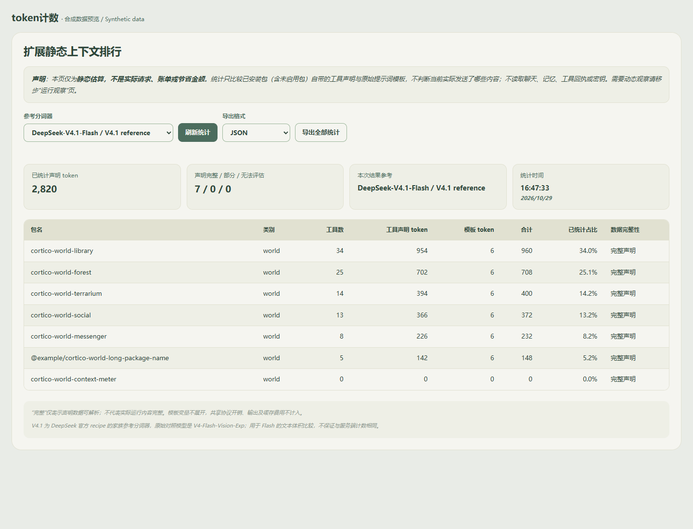
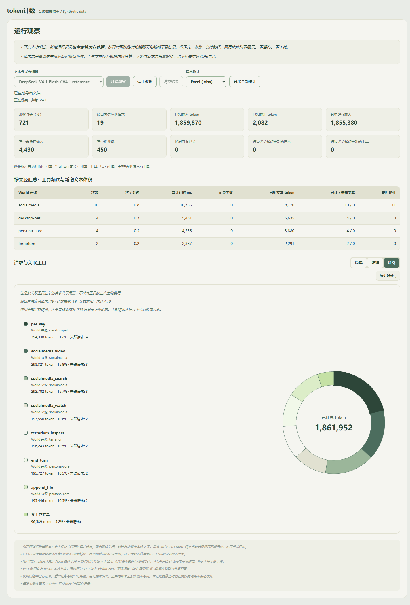

# token计数 / Token count

> **源码预览，暂未发布 npm。** v0.5.2 已处理上轮识别的依赖告警及许可不明链路；当次生产／全量已知漏洞查询均为 0，详见 [安全与隐私说明](SECURITY.md)。仍属实验性扩展，不代表官方认证、零风险或所有环境均兼容。

面向 Coopanion 的本机 token 统计面板：查看扩展静态声明体积，按需观察宿主已有的请求用量与工具操作，并通过表格、环形图、临时历史和 JSON／Excel 导出查看结果。**不额外调用模型，不自动上传统计。**

项目维护者：[CorazonYXZ](https://github.com/CorazonYXZ)。[问题反馈](https://github.com/CorazonYXZ/cortico-world-context-meter/issues) · [第三方来源与许可](THIRD_PARTY_NOTICES.md)

版本 **0.5.2**。包名 `cortico-world-context-meter`，World id `context-meter`。目标为 Coopanion v0.2.13 / Cortico v0.2.9 / World API 6。

离线比较扩展的静态声明，并按需观察宿主已有的模型请求与工具记录。不额外调用模型、不自动上传数据、不修改宿主。

## 界面预览

以下截图全部使用合成数据，展示界面与交互，不代表真实用户记录、模型账单或节省金额。





## 安装与更新

1. 从本仓库下载源码或克隆，保留完整项目目录，包括 `src`、`dist`、`assets` 和 `describe.json`。首次获取源码的用户，应先阅读 [安全与隐私说明](SECURITY.md)，了解本机统计与当前验证范围。
2. 开发环境优先使用 Node.js 24 LTS（也可使用满足 Vitest 要求的 22.12+ 或 26+ 系列）及项目指定的 pnpm；开发安装和检查命令见下文。宿主目标及运行时要求不因测试工具升级而改变。
3. Coopanion 设置窗口 → 高级模式 → 扩展 → 手动安装 → 选择本项目目录。
4. 重启 Coopanion **进程**，在 World 总览启用“token计数”，打开它的面板。

已链接安装本目录时：先停止观察、完整退出 Coopanion，再重启。若仍显示旧版，在扩展页重新选择同一目录手动安装后重启进程，并关闭再打开设置窗口。包名和 id 未变，无需卸载或重新填写供应商密钥。不要在正在观察时覆盖文件。

旧版清空或重启后已丢失的记录无法恢复。历史缓存从 v0.4 启用后的观察开始建立。更新前可先导出旧窗口。

## 静态排行

只解析直接安装扩展的包清单及指定自描述，不导入其入口。工具只计名称、说明和参数结构；模板只计原文，不展开变量，不计市场介绍、事件说明和摘要。使用排序后的紧凑 JSON，关闭自动特殊 token。

**这是声明文本估算，不是实际请求、账单或节省金额。** 包括未启用的扩展，不能判断声明是否真正发送。占比仅对应已统计声明。缺失为未知，部分数据只统计可评估部分；没有上下文声明的 provider 显示不适用。

随包分词器为 DeepSeek 官方 recipe 家族参考：V4.1 原对照 V4-Flash-Vision-Exp，供 Flash 文本体积比较；V4 原对照 V4-Pro。均不保证与服务端或当前模型分词完全一致，不含模型权重。来源、修订和校验值见 `provenance/tokenizers.json`。

## 运行观察

默认关闭，必须启用 World 后手动开始。先开始观察、执行测试、停止观察，再查看或导出。离开面板继续采集；停止或停用 World 后结束工作线程和动态日志读取。重启后不会自动恢复采集。

- 请求输入、输出、缓存和推理采用宿主供应商回执；不使用参考分词器估算这些计数。**总 token = 输入＋输出**，缓存和推理是子项，不重复相加。
- 汇总仅累计起止可确认在窗口内的供应商请求。自报、跨边界和起点未知请求保留并单列。未知不替换为零，已知合计可能不完整。
- 工具全文优先来自完整会话流水；短回执必须通过全文长度核对，截断摘要不冒充全文。只对返回文本分词，不额外打开 Markdown、重新下载网页或执行 FFmpeg。
- 图片只根据记录中的附件信息计数，不打开图片或做 OCR，不把 URL、base64 或文件大小当作文字 token。实际单图 token 未知。Flash 条件上限为新增图片数 × 1,024，仅假设全部作为图像发送，不证明实际发送、费用或重复携带；Pro 不套用此规则。规则来源：https://api-docs.deepseek.com/guides/vision/。
- 工具来源采用记录中的 World id。Persona 工具读取某扩展的文件不会自动归给该扩展。后台请求可能只有用量，没有可见操作明细；工具内部未上报步骤和绕过框架的调用可能不可见。
- 工具文本是新增返回内容估算，不是累计账单。历史重复携带、上下文折叠和共享提示词影响请求用量，不能把共享请求费用强行分给单个工具或 World。

每类最多留存 10,000 个记录／配对标识，超限明确提示。单条日志上限 16 MiB；每个文件每轮最多增量读取 4 MiB。请求与工具先按完整标识关联，不按时间或显示用短标识猜测。每次请求一行，多工具展开逐项明细；未匹配或关联不唯一的工具单列，请求计数只出现一次。

合并表最多显示 200 条主行，汇总及导出包含全部已留存记录。简单模式九列，详细模式二十一列；工具列与表头冻结。实时刷新保留显示模式、展开状态、横向位置及尽可能保持当前浏览行。

## 环形饼图

点击“简单／详细／饼图”中的“饼图”。显示偏好由宿主页面存储记住，默认仍是简单模式。桌面上左侧图例、右侧圆环；窄窗口上下排列。图例列出名称、World 来源、总 token、占比和关联请求次数，悬停或键盘聚焦会高亮对应扇区，提示显示完整数值；按 Esc 清除高亮。

- 每次请求只计一次 **输入＋输出**，缓存、推理和工具文本不重复加入。只纳入当前所选观察中窗口内的供应商请求，使用全部留存记录，不受表格排序或 200 行限制。
- 同一 World 的相同工具合并；不同 World 的同名工具分开。同一请求反复调用同种工具仍只计一次；关联多个不同工具时统一列入“多工具共享”。
- 无工具的请求列为“无关联工具”；待配对或冲突列为“关联不完整”。独立的未关联工具不增加请求 token。只按完整标识关联，不凭时间推测。
- 任一输入／输出未知时，整次请求排除，并单独列出未知请求数。中心合计和百分比分母只采用计数完整请求；因此有未知值时可能与上方分别累计已知字段的卡片合计不同。已知零值保留；无记录、全未知、真实零和安全数值溢出各有提示，不绘制误导性扇区。
- 最多十个扇区；超过十类时保留最大的九类，其余归为“其他”。展开“查看其他分类”可滚动查看全部成员、数值及其占整个饼图的比例。正数占比小于 0.1% 显示“＜0.1%”，绘图保留原始比例。
- 实时刷新保留仍可见分类的高亮、颜色及“其他”展开状态。历史切换时整个饼图跟随所选快照。饼图保留历史入口、隐藏表格排序；返回表格保留排序及工具展开状态。

**这是按关联工具汇总的请求共享用量，不代表工具独立产生的费用。** 图形只用于面板展示；JSON／Excel 继续导出原有统计和关联数据，不附加饼图或分类账单。图形使用原生 SVG，不增加依赖、网络、模型调用或文件采集范围。

## 临时历史

“简单／详细／饼图”下方的“历史记录 ⌄”默认收起，点击展开。列表显示时间段、请求数、已知总 token 和完整性状态，可查看、重命名或删除；回看时整页统计卡片、World 汇总和合并表一起切换，并显示历史横幅。

- 统计每 **10 秒**自动保存一次，停止、清空、开始下一次观察和正常停用前保存最终快照。同一窗口更新同一条记录，不产生每 10 秒一条的重复历史。
- 默认名称为本机时间起止，例如 `2026-10-29 11:30:00—2026-10-29 12:00:00`。名称最多 80 个字符，只作为文字展示，不作文件路径；重命名不延长保留期限。
- 默认保留 **7 天、最多 30 次／64 MiB**，在保存或访问历史时清理到期或最旧的非活动记录。当前采集窗口不被淘汰。单快照最大 32 MiB。
- “清空当前结果”保留历史；删除历史需再次点击确认，不删除已经下载的文件。正在采集的历史不能删除。
- 查看历史不停止当前采集，实时刷新不覆盖历史视图。开始、停止、清空始终操作当前窗口并切回当前视图；“返回当前观察”可随时返回。
- 重启后只能回看保存结果，不恢复采集。异常退出的快照标记“中断，保存至某时”，结束时间保持未知，不假装完整结束。正常写入时可能缺少最后约 10 秒；保存失败时以最后成功快照为准。
- 保存失败会显示提示，内存结果仍保留。若尚未保存的窗口将被清空或替换，操作失败并保留原结果，可先手动导出再检查本机保存状态。
- 缓存目录是框架 `dataDir/context-meter/history/`；仅读写本扩展登记的 UUID 快照、索引与固定临时文件，原子替换，拒绝越界、目录链接、文件链接和硬链接。格式损坏时提示，不执行缓存内容，不读取未登记文件。

## 自选排序

“排序 ⌄”同样默认收起，展开后选择排序列及升序／降序，或恢复默认。默认完成时间从新到旧，支持全部简单／详细列；当前模式未显示的列标注“详细列”。切换模式保留排序条件。

先关联全部记录，再排序，再截取 200 行。数值按数值、时间按时间、文字按语言比较；未知始终在末尾，并列按时间倒序和完整标识稳定排列。

多工具数值按本行合计排序，任一所需值未知则排序值未知；工具完成时间取最晚，失败取任一失败，文字采用全部名称的稳定组合。它们只是排序依据，逐工具数据和费用归属不变。手动排序回到表格顶部，实时更新保持条件；模式和排序偏好由宿主页面存储保存，两个折叠区域每次打开仍收起。

## JSON／Excel 导出

两个页面均可选择 JSON 或真正的 Excel `.xlsx`。运行页导出当前选中的一次观察，静态页导出当前观察；均含对应静态快照。历史记录采用保存时的静态结果，不混入之后其他窗口的数据。未取得静态结果时 JSON 为 `null`，Excel 静态页只有表头。

导出包含全部已留存请求、工具、完整散列关联标识、来源汇总、缺失计数、覆盖提示、数据源状态、时间和版本，不受 200 行、简单／详细模式或排序影响。它不能补齐未采集的调用，也不修正与官网的用量差额。

Excel 六张表为：概览、模型请求、工具明细、请求工具关联、World 汇总、静态排行。请求／工具分别一行，关联另表，避免多工具重复累计请求 token。数值保持数值，未知留空且概览注明；文字按普通文本写入。表头、筛选和交替背景沿用绿系，语言跟随面板。

Excel 由本机独立 Node 工作线程生成，只接收统计白名单快照，生成时不读取源日志或聊天，不写临时 Excel 文件。宿主通过 `$binary` 返回 XLSX 字节，页面用 `ctx.invokeBinary()` 取文件。生成不占用界面线程或采集线程，不访问 CDN。

同一扩展一次生成一个 Excel，超时为 60 秒；完成、失败、超时、离开面板或停用扩展均释放线程。面板卸载只取消自己归属的任务；先收到取消、后到达的导出请求也不会启动。原始异常、正文及文件路径不会出现在错误提示中。

常见错误码：`E_EXPORT_DATA` 表示所选记录不可用；`E_XLSX_BUSY` 表示已有任务；`E_XLSX_START`／`E_XLSX_GENERATE` 分别表示线程启动／生成失败；`E_XLSX_TIMEOUT` 表示超过 60 秒；`E_EXPORT_TRANSPORT` 表示文件传输异常；`E_EXPORT_DOWNLOAD` 表示下载准备失败。错误提示同时显示版本，便于排查。Excel 暂不可用时仍可选择 JSON 保存统计。

保存文件名为 `token-count-时间.json`／`.xlsx`。JSON 保留原字段，增加所选记录的名称、标识和保存状态。保存或分享文件由用户手动操作，不自动上传。它仍含时间、模型、扩展及工具使用信息，请自行决定分享对象。

## 文件与隐私边界

静态统计只读框架指定扩展目录的依赖清单、直接安装扩展的包清单及其指定的包内自描述，支持 pnpm 与本机目录链接，不递归扫描其他依赖。

动态观察只在开启时读取 `WorldContext.dataDir` 的 `usage.jsonl`、`runs/index.jsonl` 与经 id／当前进程 pid 校验的当前运行 `toolcalls.jsonl`、`transcript.jsonl`。从末尾建立基线，不回读旧正文；索引最多读取尾部 64 KiB，旧日志只检查末尾换行，文件替换或截断后不回放旧内容。

新增记录可能包含聊天及敏感工具结果，正文只在本机内存临时处理，不进入页面、缓存、导出或日志。**缓存和导出只使用统计字段白名单**，不含正文、参数、源文件内容、文件路径、网页地址、API Key、认证头或配置。不开源 Markdown／图片／密钥文件，不调用模型、不推送唤醒事件、不上传、不重抓网页。

历史功能只新增本扩展缓存目录的读写，不扩大宿主日志采集范围。回看和导出历史只读取已保存统计，不读取宿主历史运行目录。运行时网络仅使用宿主本机面板接口及随包前端／工作线程资源。

**统计文件并非完全匿名。** 本机历史为明文统计，可能反映使用时间、模型、工具／扩展名称、关联标识及自定义历史名称；分享前请检查。七天过期清理在保存／访问历史时执行，停止或卸载不保证届时自动清除。清空当前结果不删除历史，删除历史不删除已下载文件。

## 开发与验证

在已准备 Corepack 的环境运行：

```sh
corepack pnpm install
pnpm typecheck
pnpm build
node scripts/licenses.mjs
pnpm test
pnpm check:security
node scripts/official-check.mjs --describe
pnpm check:extension
```

本工作区使用相邻 `.tooling` 中的局部 Corepack／pnpm 和专用依赖缓存，验证安装命令带 `--store-dir ../.tooling/pnpm-store`。`node --import tsx scripts/preview.mjs` 使用合成数据和隔离 Edge 验证真实下载、历史回看、排序和布局，不打开用户的 Coopanion 或真实运行文件。详细结果见 `VALIDATION.md`。

原创代码为 MIT；Cortico 模板、DeepSeek 分词器、Hugging Face 分词库、ExcelJS 及其依赖的来源、版本和许可见 `THIRD_PARTY_NOTICES.md`、`licenses/`、`provenance/` 和锁文件。

## English

An offline World for static declaration ranking and opt-in observation of host-recorded model/tool usage. No extra model calls, uploads or host changes. Install in Coopanion v0.2.13: Settings → Advanced mode → Extensions → Manual install → select the project directory → restart the process → enable Token count in Worlds.

**Source preview only; not published to npm in this submission.** Version 0.5.2 addresses the previously identified dependency advisories and removes the unclear-license chain. The recorded production and full dependency checks report zero known advisories; see [SECURITY.md](SECURITY.md). This is not official certification or a zero-risk guarantee. Screenshots use synthetic data. History and exports contain usage metadata and are not fully anonymous; local history is plaintext and expiry cleanup runs on save/access.

Version 0.5.1 simplifies the panel copy: italic introductions with emphasized key phrases, and smaller muted gray-green footer notes. The persistent export explanation is removed; progress, a short success message and versioned errors remain. Observation state labels, statistics, chart, history and export formats are unchanged.

Version 0.5.2 bundles the official ExcelJS Node entry and repaired dependency tree into the existing local worker, without runtime ExcelJS installation. UUID is fixed at 11.1.1, unzipper at 0.12.5, and Vitest/Vite at 5.0.5/8.3.5. Development prefers Node.js 24 LTS; supported 22-series versions start at 22.12. Build inputs, licenses and dated production/full audit results are recorded under provenance. Some upstream deprecation notices remain; no suppression is used to hide security findings.

Version 0.4 adds JSON / Excel export, temporary local history and sortable merged rows. History and Sort controls sit below Simple / Detailed and start collapsed. History is saved every 10 seconds and at stop, clear, replacement or normal shutdown; one window updates one record. Retention is 7 days, 30 sessions / 64 MiB, with a 32 MiB per-file limit. Active captures are protected. Expiry/eviction runs on save or access; rename does not extend retention.

Version 0.5 adds a native SVG ring chart beside Simple / Detailed. It groups input + output tokens of all retained in-window provider requests, once per request: identical tool names merge only within the same World; multiple distinct tools share one category; missing or ambiguous links remain explicit. Complete known requests alone form the center total and percentage denominator, with unknown counts shown separately. No-record, all-unknown, zero and unsafe-total states never draw misleading slices. More than ten categories use the top nine plus expandable Other details. Hover or keyboard focus highlights legend/slices; Escape clears the highlight. History follows the selected snapshot, while table sorting is hidden only in chart mode and restored on return. This is shared request usage, not a tool's independent cost. No chart export, dependencies, data access or schema changes were added.

Clear preserves history. History can be viewed, renamed (80 characters) or deleted; deletion does not remove downloaded files. Viewing a saved session updates the entire dashboard while live capture may continue. Start/stop/clear target the current window and return to it. Restart defaults to capture off. Interrupted history recovers only the last successful checkpoint, with an unknown actual end. Failed saves retain memory and block replacement/clear of unsaved results.

Sorting uses all linked rows before the 200-row display limit; default is completion time descending. Unknowns stay last in either direction. Multi-tool numeric sort keys are sums only when all required values are known; latest completion and any-failed status are used. Sorting is a display operation, not an allocation of request costs. Mode and sort preferences persist, while disclosure controls start closed.

Export targets the selected observation, includes its static snapshot and all retained metadata, and is independent of display limits/sorting. Excel has six localized sheets: Overview, Requests, Tools, Request tool links, World summary and Static ranking. Numeric cells remain numeric; unknowns are blank. Request totals are input + output only; subsets/tool estimates are never added again. Version 0.4.2 generates Excel in an offline Node worker and returns it through the host's binary interface; it creates no browser Worker or temporary workbook file. One job runs at a time, with a 60-second timeout and owner-scoped cancellation on unmount. Completion, failure, timeout and World stop release the thread. Versioned fixed error codes expose no raw exceptions. JSON remains compatible.

Only allowlisted statistics are saved under the framework data directory's context-meter/history folder or manually exported. No chat, bodies, arguments, source file contents, paths, URLs, configuration or keys are retained or uploaded. No host-history replay occurs. Previously discarded v0.3 records cannot be recovered. Source/contract checks, tests and isolated browser QA use synthetic data; actual desktop-host installation remains user-verified. npm publication and market synchronization require a separate decision.
